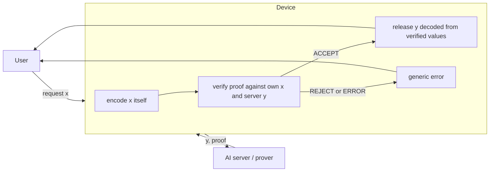
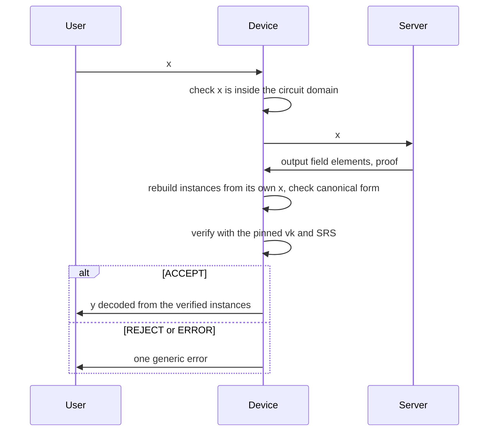

# Proof-gated egress

A hardened, off-the-shelf device that lets AI outputs leave a datacenter only if they carry a valid zero-knowledge proof. Threat model, measurements and guidance for frontier AI labs.

This work was supported by ERA's Frontier AI Security Residency (October to December 2026).

The write-up (design, threat model, attack catalogue, results) is a book in `book/`: build it with [mdBook](https://github.com/rust-lang/mdBook) 0.5.4, `mdbook build book`, then open `book/book/index.html`.

> Early work in progress. Nothing here is production security. Claims are limited to what the tests and measurements show.

## Idea

A compromised AI server could leak model weights inside ordinary answers. If every answer must carry a proof that it came from the approved model on that exact request, a small device at the boundary can check the proof and block everything else. The problem shrinks from securing a datacenter to securing one device.

A valid proof removes the server's choice over what an answer says. It does not cover when, whether or how the answer is delivered. Those channels are part of what this project measures.



The device only listens on the outside. It connects to the server itself, although that connection still carries hostile data. The service (`pge/service.py`, `docs/SERVICE_SPEC.md`) releases answers in arrival order by default (v1 software); `--release immediate` is v0's behaviour and `--release fixed` sends every answer at admission + deadline.

## Request path



## Versions

| Version | What it is |
|---|---|
| v0 baseline | The verifier as a normal program on standard Raspberry Pi OS |
| v1 stripped | A minimal Buildroot system that runs only the verifier; two wired ports; a strict binary message format; fuzzed |
| v2 hardened | A fixed release schedule in arrival order, signed and rollback-protected updates, and secure boot; optionally a TPM counter |

Each version is measured the same way: reachable services, trusted code size, verification time, and leakage through each side channel under tested attacks.

## What's here

| Path | Contents |
|---|---|
| `pge/binding.py` | Encode the request exactly as EZKL does, validate the server's outputs, decode verified outputs |
| `pge/bundle.py` | Load a bundle only if settings, vk and SRS match their pins |
| `pge/domain.py` | Input domain of an affine + ReLU circuit, so impossible requests are refused up front |
| `pge/verdict.py` | Turn a verify call into ACCEPT, REJECT or ERROR |
| `pge/worker.py` | Run one verify in a child process with a deadline |
| `pge/protocol.py` | The service's wire format: length-prefixed binary frames of fixed size for the pinned circuit, strict parsing |
| `pge/service.py` | The gate service: one bundle, at most one answer per request, released in arrival order; the decoded output or an error that never carries server-chosen text; logs with fixed words only |
| `pge/cli.py` | Verify with EZKL's official CLI (no Python package exists for Pi OS), with a deadline on its whole process group |
| `docs/BINDING_SPEC.md` | The binding rules, pitfalls and test vectors |
| `docs/SERVICE_SPEC.md` | The gate service (v1 software): frames, messages, request lifecycle and arrival-order release, failure policy, verifier limits, replay, logs |
| `docs/THREAT_MODEL.md` | Threat model v0: assets, attackers, assumptions, the v0 attack surface, side channels and their status |
| `docs/ATTACKS.md` | Known-attacks catalogue: every attack tried, its result and the test that covers it |
| `tests/` | Unit tests, differential tests against EZKL's own encoding and witness generation, end-to-end verification |
| `tests/fixtures/` | Two pinned bundles: `tiny` (y = ReLU(xW + b), 4 to 3, with its input domain in `domain.json`) and `multi` (two inputs, two outputs, scales 13 and 26) |
| `prover/` | Build and prove the test circuits with EZKL; tamper checks; `server.py`, the laptop AI server, honest or misbehaving |
| `observer/client.py` | The outside observer: sends requests to the gate (one at a time or in batches) and records each answer with its time; decoders for the timing, ordering and failure-position channels |
| `observer/analyze_matrix.py`, `observer/jitter_test.py`, `observer/order_experiment.py` | Summarise a release-policy run; test whether residual jitter follows planted bits; the ordering channel on localhost |
| `device/pi_scenario.sh`, `device/pi_matrix.sh` | Run one gate scenario on the Pi (prover and observer on this machine), or the release-policy x channel matrix |
| `device/verify_cost.py` | What one gate check costs on the device, and how reliably the CLI runs under each memory limit |
| `book/` | The write-up as an mdBook; its pages include the files in `docs/` |
| `device/verify_on_pi.sh` | Stage the pinned tiny bundle and run the device checks on the Pi over SSH, or locally on Linux with `HOST=local` |
| `device/check_verifier.sh` | The device checks: fetch the pinned EZKL CLI, check accept and reject cases, time verification |
| `spike/stwo-verifier/` | Spike: a pinned S-two (Cairo) verifier on StarkWare's stwo-cairo `sharp-7.4`: size caps, pinned security parameters and program hash, 55 cases (`check.sh`), deterministic fixtures (`prove.sh`) |
| `image/build.sh`, `image/v1.fragment` | Build the device image with Buildroot 2025.02.18 LTS (digest-pinned) on a Linux host: the Pi 4 defconfig plus glibc and Python. Work in progress towards v1 |
| `device/measure.sh` | Attack-surface snapshot for every version: packages, running services, processes, listening sockets, hashes of config and tools |

## Running the tests

```
uv venv --python 3.12 .venv
uv pip install --python .venv/bin/python "ezkl==23.0.5" onnx numpy pytest
.venv/bin/python -m pytest -q
```

The verification tests need the pinned SRS. They use `prover/artifacts/kzg.srs` or `$PGE_SRS` if present and otherwise download it with EZKL's `get_srs`, then check the pin. CI sets `PGE_REQUIRE_INTEGRATION=1`, so a missing SRS or EZKL fails the run instead of skipping those tests.

`tests/test_cli.py` runs `pge/cli.py` against stub CLIs, and against the real CLI when `PGE_EZKL_CLI` points to it (CI does this). `tests/test_device_script.py` runs the device checks against a stub CLI and only runs on Linux. CI also runs `device/verify_on_pi.sh` with `HOST=local` and EZKL's x86_64 Linux CLI.

## Running the gate service

On the laptop, start the AI server, then the gate (with EZKL's CLI on Linux):

```
.venv/bin/python prover/server.py --listen 127.0.0.1:8701
python3 -I -c 'import sys; sys.path.insert(0, "."); from pge.service import main; main()' \
  --listen OUTSIDE_IP:8700 --server 127.0.0.1:8701 --bundle BUNDLE_DIR --pins device/tiny.sha256 \
  --cli ./ezkl --domain tests/fixtures/tiny/domain.json --proof-bytes 3072 [--log gate.log] [--release immediate]
```

`OUTSIDE_IP` is the outside interface's own address; don't use `0.0.0.0`, which listens on every interface. `BUNDLE_DIR` holds `settings.json`, `vk.key` and `kzg.srs`. `prover/server.py --mode` makes the server misbehave (see its docstring). Run on the Pi on 16 Oct with the v0 software and on 19 Oct with the v1 software (below).

## Measured so far

| What | Where | Result |
|---|---|---|
| Prove / verify, tiny circuit, in-process | laptop (M4 Pro) | about 0.5 to 0.8 s / 8 to 14 ms |
| Verify, whole CLI process, n = 20 | Raspberry Pi 4 (13 Oct, earlier script) | 99 to 103 ms |
| Verify, whole CLI process, n = 20 | Raspberry Pi 4 (16 Oct, current `device/verify_on_pi.sh`) | 101 to 106 ms, median 103 |
| Gate on the Pi (v0 software), prover on the laptop, one request | Pi 4 + M4 Pro over Ethernet, 16 Oct | 0.9 to 1.05 s per answer (mostly proving); y matches the float model within quantisation |
| Misbehaving server against the gate on the Pi (v0 software, 16 Oct) | tamper, replay, duplicate, wrong seq, garbage, oversize | blocked or dropped as specified |
| Timing leak through v0 (16 bits, 1 s slots) | Pi gate | 16 of 16 bits decoded from answer times; honest answers vary by 81 ms |
| Gate on the Pi (v1 software), one check | Pi 4, 19 Oct | 239 ms for the full check (one thread, limits); 163 ms raw CLI with one thread, 97 ms with four |
| Release policies on the Pi (16 bits per channel, 4 s budget) | Pi gate, 19 Oct | timing 16/16 leaked under immediate and arrival, chance under fixed; ordering 16/16 under immediate only; failure position 16/16 under every policy; fixed costs 4.0 s per answer (0.8 s otherwise) |
| Residual timing under fixed release (128 bits + honest control) | Pi gate, 19 Oct | 0.66 ms shift follows the server's delays (p < 0.0001; control p = 0.13); about 0.14-0.19 bit per answer held-out |
| Open TCP ports seen from the laptop (nmap) | Pi, v0 | 22 (ssh), 8700 (gate) |
| Raw proof size | | 3072 bytes |
| S-two proof (binary), verify with all pins, n = 20 | laptop (M4 Pro) | 455-870 KB; median 36-65 ms per process, 9-15 MB peak RSS (`spike/stwo-verifier`) |
| S-two proof (binary), verify with all pins, n = 20 | Raspberry Pi 4 (19 Oct) | median 122 ms (455 KB) and 254 ms (870 KB); under 9 MB peak memory |
| S-two proof with 2-bit security parameters | laptop | accepted by stwo-cairo's own `verify` CLI; rejected by the pinned verifier |
| Tampered input, output and proof bytes | laptop | rejected |
| Tampered input, output, garbage file | Raspberry Pi | rejected (non-zero exit) |

The current device checks pass with the real aarch64 CLI in a Debian 13 container and with the x86_64 CLI in CI, and fail as expected against a stub CLI. On 16 Oct they passed on the Pi as well.

## Scope

In scope: hardening and measuring the verifying device, request binding, the update path, secure boot, and side channels a compromised server controls: timing, ordering, deliberate failures, packet sizes and header fields.

Out of scope: the soundness of the proof system, physical attacks (including physical side channels such as power or EM), and what ordinary outputs reveal about a model.
