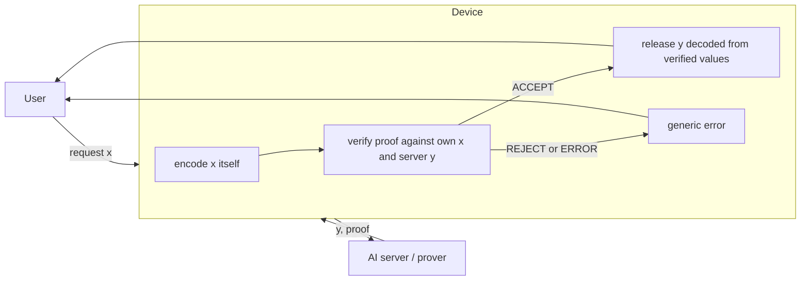
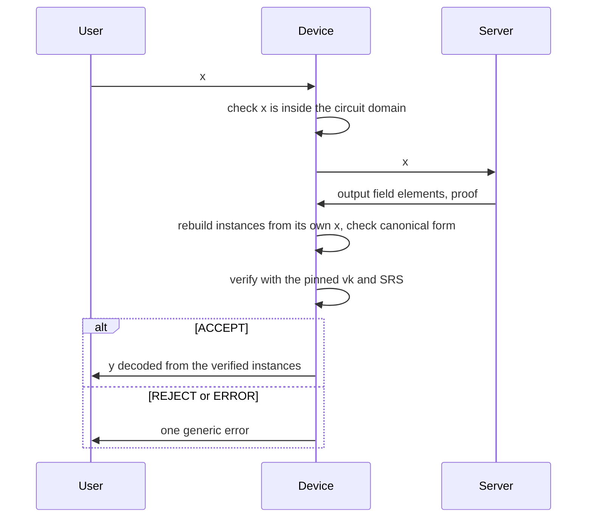

# Proof-gated egress

A hardened, off-the-shelf device that lets AI outputs leave a datacenter only if they carry a valid zero-knowledge proof. Threat model, measurements and guidance for frontier AI labs.

Built during ERA's Frontier AI Security Residency (FASR), October to December 2026.

> Early work in progress. Nothing here is production security. Claims are limited to what the tests and measurements show.

## Idea

A compromised AI server could leak model weights inside ordinary answers. If every answer must carry a proof that it came from the approved model on that exact request, a small device at the boundary can check the proof and block everything else. The problem shrinks from securing a datacenter to securing one device.

A valid proof removes the server's choice over what an answer says. It does not cover when, whether or how the answer is delivered. Those channels are part of what this project measures.



The device only listens on the outside. It connects to the server itself, although that connection still carries hostile data. The v0 service (`pge/service.py`, `docs/SERVICE_SPEC.md`) releases as soon as a check passes; the fixed release time is v2 target behaviour.

## Request path



## Versions

| Version | What it is |
|---|---|
| v0 baseline | The verifier as a normal program on standard Raspberry Pi OS |
| v1 stripped | A minimal Buildroot system that runs only the verifier; two wired ports; a strict binary message format; fuzzed |
| v2 hardened | A fixed release schedule in arrival order, signed and rollback-protected updates, and secure boot; optionally a TPM counter |

Each version is measured the same way: reachable services, trusted code size, verification time, and leakage through each side channel under tested attacks.

## What's here

| Path | Contents |
|---|---|
| `pge/binding.py` | Encode the request exactly as EZKL does, validate the server's outputs, decode verified outputs |
| `pge/bundle.py` | Load a bundle only if settings, vk and SRS match their pins |
| `pge/domain.py` | Input domain of an affine + ReLU circuit, so impossible requests are refused up front |
| `pge/verdict.py` | Turn a verify call into ACCEPT, REJECT or ERROR |
| `pge/worker.py` | Run one verify in a child process with a deadline |
| `pge/protocol.py` | The service's wire format: length-prefixed JSON frames, strict parsing |
| `pge/service.py` | The v0 gate service: one bundle, one answer per request, the decoded output or one generic error |
| `pge/cli.py` | Verify with EZKL's official CLI (no Python package exists for Pi OS), with a deadline on its whole process group |
| `docs/BINDING_SPEC.md` | The binding rules, pitfalls and test vectors |
| `docs/SERVICE_SPEC.md` | The v0 service: messages, request lifecycle, failure policy, replay |
| `tests/` | Unit tests, differential tests against EZKL's own encoding and witness generation, end-to-end verification |
| `tests/fixtures/` | Two pinned bundles: `tiny` (y = ReLU(xW + b), 4 to 3, with its input domain in `domain.json`) and `multi` (two inputs, two outputs, scales 13 and 26) |
| `prover/` | Build and prove the test circuits with EZKL; tamper checks; `server.py`, the laptop AI server, honest or misbehaving |
| `device/verify_on_pi.sh` | Stage the pinned tiny bundle and run the device checks on the Pi over SSH, or locally on Linux with `HOST=local` |
| `device/check_verifier.sh` | The device checks: fetch the pinned EZKL CLI, check accept and reject cases, time verification |

## Running the tests

```
uv venv --python 3.12 .venv
uv pip install --python .venv/bin/python "ezkl==23.0.5" onnx numpy pytest
.venv/bin/python -m pytest -q
```

The verification tests need the pinned SRS. They use `prover/artifacts/kzg.srs` or `$PGE_SRS` if present and otherwise download it with EZKL's `get_srs`, then check the pin. CI sets `PGE_REQUIRE_INTEGRATION=1`, so a missing SRS or EZKL fails the run instead of skipping those tests.

`tests/test_cli.py` runs `pge/cli.py` against stub CLIs, and against the real CLI when `PGE_EZKL_CLI` points to it (CI does this). `tests/test_device_script.py` runs the device checks against a stub CLI and only runs on Linux. CI also runs `device/verify_on_pi.sh` with `HOST=local` and EZKL's x86_64 Linux CLI.

## Running the v0 service

On the laptop, start the AI server, then the gate (with EZKL's CLI on Linux):

```
.venv/bin/python prover/server.py --listen 127.0.0.1:8701
python3 -I -c 'import sys; sys.path.insert(0, "."); from pge.service import main; main()' \
  --listen 0.0.0.0:8700 --server 127.0.0.1:8701 --bundle BUNDLE_DIR --pins device/tiny.sha256 \
  --cli ./ezkl --domain tests/fixtures/tiny/domain.json
```

`BUNDLE_DIR` holds `settings.json`, `vk.key` and `kzg.srs`. `prover/server.py --mode` makes the server misbehave (see its docstring). Not yet run on the Pi.

## Measured so far

| What | Where | Result |
|---|---|---|
| Prove / verify, tiny circuit, in-process | laptop (M4 Pro) | about 0.5 to 0.8 s / 8 to 14 ms |
| Verify, whole CLI process, n = 20 | Raspberry Pi 4 (13 Oct, earlier script) | 99 to 103 ms |
| Raw proof size | | 3072 bytes |
| Tampered input, output and proof bytes | laptop | rejected |
| Tampered input, output, garbage file | Raspberry Pi | rejected (non-zero exit) |

The current device checks pass with the real aarch64 CLI in a Debian 13 container and with the x86_64 CLI in CI, and fail as expected against a stub CLI. They have not been re-run on the Pi yet.

## Scope

In scope: hardening and measuring the verifying device, request binding, the update path, secure boot, and side channels a compromised server controls: timing, ordering, deliberate failures, packet sizes and header fields.

Out of scope: the soundness of the proof system, physical attacks (including physical side channels such as power or EM), and what ordinary outputs reveal about a model.
