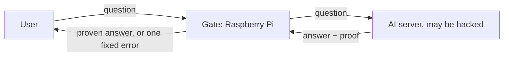

# Proof-gated egress

A small device that lets an AI server's answers out only if each one carries a valid cryptographic proof that the approved model produced it. This repository has the device's software, its threat model, every attack tried against it, and the measurements.

This work was supported by ERA's Frontier AI Security Residency (October to December 2026).

> Work in progress. Nothing here is production security. Every claim is limited to what the named test or measurement shows.

## The idea

A hacked AI server, or a model acting against its owners, could try to smuggle the model's weights out inside ordinary answers. Put a checkpoint between the server and the outside world: a Raspberry Pi (the **gate**) that checks a proof for every answer and blocks anything that doesn't check out.



A valid proof stops the server from changing **what** an answer says. It doesn't stop it from signalling through **when** answers leave, **in what order**, or **which ones fail**. Measuring and closing those signals is the other half of the project.

## What we found

<!-- BEGIN findings: copied from book/src/results.md; tests/test_docs.py fails if they differ -->
| Way to smuggle data out | Basic gate | Best gate so far | What it costs |
|---|---|---|---|
| Change what an answer says | Blocked by the proof | Blocked | Each check takes about 0.24 s on the Pi |
| Reorder answers | Leaks | **The ordering code we tried no longer gets through**: answers leave in the order questions arrived | A slow answer delays the ones behind it |
| Delay answers | Leaks | **Much reduced**: each answer has a set release time and can't leave before it; a small trace remained without spin, and with spin a 512-answer test was inconclusive | Answers take 4.0 s instead of about 0.8 s |
| Fail chosen answers on purpose | Leaks | **Still leaks** | Open problem |
<!-- END findings -->

Measured on a real Raspberry Pi 4 with one client at a time and one tiny test model; the rates are for the encoders we tried, not limits on what an attacker could do. Every scenario we catalogued, with its evidence, is in the [attack catalogue](docs/ATTACKS.md).

## Status

<!-- ANCHOR: status -->
| Version | What it is | Status |
|---|---|---|
| v0 | The checking software on the Pi's standard operating system | Done and measured |
| v1 | Stricter software (fixed message format, release in arrival order or at a fixed time, contained checker, fixed-word logs) on a stripped-down system with nothing else running | Software done and measured on the standard system; the stripped system boots, the software isn't on it yet |
| v2 | Secure boot, signed versioned updates, fixed time slots, a hash-chained log | Planned |
<!-- ANCHOR_END: status -->

## Read more

The write-up is a short book in `book/`. Its pages, readable here on GitHub:

- [Overview](book/src/introduction.md)
- [How the gate works](book/src/tour.md) (the whole system on one page, with diagrams)
- [What a hacked server can still leak](book/src/leakage.md)
- [How hard the gate is to attack](book/src/hardening.md)
- [Measurements](book/src/results.md)
- [Limitations and open questions](book/src/limitations.md)
- Reference: [threat model](docs/THREAT_MODEL.md), [attack catalogue](docs/ATTACKS.md), [gate service spec](docs/SERVICE_SPEC.md), [request binding spec](docs/BINDING_SPEC.md), [reproduce](book/src/reproduce.md), [repository map](book/src/repo-map.md), [glossary](book/src/glossary.md)

To read it as a website, build it with [mdBook](https://github.com/rust-lang/mdBook) 0.5.4: `mdbook serve book`, then open http://localhost:3000.

## Quick start

```sh
uv venv --python 3.12 .venv
uv pip install --python .venv/bin/python "ezkl==23.0.5" onnx numpy pytest
.venv/bin/python -m pytest -q
```

The tests download the proof system's pinned setup file if `prover/artifacts/kzg.srs` isn't present. Running the gate and the Pi experiments: [Reproduce the results](book/src/reproduce.md).

## Scope

In scope: hardening and measuring the gate, tying each proof to its question, the update path, secure boot, and signals a hacked server controls (timing, order, deliberate failures, packet sizes and headers).

Out of scope: whether the proof system itself is sound, physical attacks on the device (including power or electromagnetic side channels), and what ordinary correct answers reveal about a model.
