# The system on one page

> **In short**
> - One page that walks through every part of the gate, with a diagram for each, the code that implements it and the evidence behind it.
> - Read it after the [Overview](introduction.md). The other pages go deeper; this one connects them.
> - Numbers are as of 20 October 2026. Where a number appears here and in [Measurements](results.md), that page is the reference.

## The pieces

Two machines and two network links. Today the laptop plays both the AI server and the outside observer, and the Pi runs the gate. The gate listens only on the outside link and dials out to the server itself, so it has no listener for the server to connect to.

| Piece | File | Job |
|---|---|---|
| Gate service | `pge/service.py` | Admits questions, forwards them, checks answers, decides when replies leave |
| Message format | `pge/protocol.py` | Fixed-size binary frames; strict parsing |
| Binding | `pge/binding.py`, `pge/bundle.py`, `pge/domain.py` | Encodes questions like EZKL, pins the model, decodes proven outputs, refuses impossible questions |
| Checker | `pge/cli.py`, `pge/proc.py`, `pge/verdict.py` | Runs EZKL's command-line tool under limits and turns its output into a verdict |
| Server | `prover/server.py` | Proves each question with EZKL; can misbehave on purpose (tamper, replay, delay, hide bits) |
| Observer | `observer/client.py` | Sends questions, records each reply and its arrival time, decodes hidden bits |

Today both links share one Ethernet cable, so the separation between the server side and the outside side is only by address. The v1 image gives the Pi a second wired port so the two sides are physically separate and nothing is forwarded between them.

## The life of one question

The server never gets to say what the question was. The gate rebuilds that part of the proof itself, so the server only supplies outputs and a proof, and they count only if the proof over the gate's question and those outputs verifies.

| Step | Code | Evidence |
|---|---|---|
| Read and parse the question | `serve_client` and `parse_request` | `test_client_violation_closes_the_connection` |
| Encode, check, admit or refuse | `submit` | `test_bad_requests_never_reach_the_server` |
| Accept the first answer only | `on_answer` | `test_duplicate_answer_gives_one_reply`, `test_late_answer_is_dropped_and_answered_once` |
| Build instances, verify, decide | `_check` | `test_proof_for_another_request_is_blocked` |
| Decide when the reply leaves | `_release` and `_pump` | [When answers leave](#when-answers-leave) |

- **Malformed frames:** a bad frame from a user closes that user's connection; a bad frame from the server drops the server link and fails every pending question, because a broken message can't be tied to one question.
- **Deadline:** checked before a check starts and again when the result comes back, so a late result can't slip out.
- **One decision per question:** late, duplicate and unknown answers from the server are counted and dropped, never sent to a user.

## How a proof is tied to the question

A valid EZKL proof only says "this circuit turned these public input values into these public output values". Binding makes it a proof about **this** question, **this** model and **this** reading of the output, by never taking any of the three from the server.

**The five rules**

1. **One pinned model.** The gate loads one bundle: `settings.json`, the verification key `vk.key` and the setup file `kzg.srs`, each pinned by SHA-256 and re-checked before every verify. The server can't pick another model or key.
2. **The gate encodes the question.** It computes the input values exactly as EZKL does, so a proof made for any other question fails.
3. **Outputs are read only from verified values.** The server's outputs are released only if the proof over the gate's inputs and those exact outputs verifies. The gate never uses an answer the server states, and never reads the proof file's unbound fields (`pretty_*`, `timestamp`, `hex_proof`).
4. **The proof length is pinned.** EZKL accepts a valid proof with extra bytes appended, which would be a free channel, so any length other than 3,072 bytes is rejected.
5. **Impossible questions are refused up front.** A question that would overflow EZKL's range checks can't be proved, so it gets `bad_request` before it reaches the server; otherwise anyone could make the server fail on demand.

**What went wrong without each rule**

| Pitfall | What happened | Rule |
|---|---|---|
| Settings not pinned | Changing only the output scale from 26 to 13 kept the proof valid but decoded 0.9666 as 7918.6 | 1 |
| Python rounding | Python's `round()` rounds half to even: 2.5/8192 encodes as 2, EZKL gives 3 | 2 |
| Server-supplied answer | The server could state any answer next to a valid proof | 3 |
| Padded proofs | EZKL still accepts a valid proof with bytes appended | 4 |
| Out-of-domain questions | A question no proof can exist for makes the server fail on demand | 5 |

**Worked example** (the tiny test model, y = ReLU(xW + b), 4 inputs and 3 outputs): x = [0.5, -0.2, 0.9, 0.1] encodes to inputs [4096, -1638, 7373, 819] at scale 13; the proven outputs are [64869479, 0, 0] at scale 26, which decode to y = [0.9666305631399155, 0, 0].

**Limits**

- It binds the **encoded** value, not the raw number: 0.5 and 0.50001 both encode to 4096, so one proof serves both.
- **Replay:** the proof has no nonce. The gate answers each pending question once and drops duplicates, so nothing is delivered twice, but an old proof for the same encoded question still verifies for a new request. For one deterministic model that gives the server no choice of output; it isn't proof of fresh computation.
- The rules are specific to EZKL 23.0.5 and these test models; another proof system needs its own.

Full rules and test vectors: [Request binding specification](binding-spec.md).

## The checker

The cryptography is done by EZKL's official command-line tool (23.0.5 for 64-bit ARM, download checked against its published digest; Raspberry Pi OS has no EZKL Python package). The gate treats it as untrusted: one short-lived process per check, boxed in by limits, whose only way to say yes is a strict exit code and log line.

| Limit | Value | Why |
|---|---|---|
| Address space (Linux only) | 256 MiB | Stops a proof that makes the verifier allocate without bound |
| CPU time | up to the deadline | A second stop for a busy loop, besides the wall-clock deadline |
| File size | 0 | Verify writes no files; a CLI that tries is killed (this doesn't stop it deleting files) |
| Open files | 64 | Bounds file-handle exhaustion |
| Core dumps | off | No memory dumps on disk |
| Threads | Rayon set to 1 (a setting, not an OS limit) | Less memory, steadier timing |
| Output | 64 KiB, then SIGKILL | A flooding child can't exhaust the gate |
| Wall time | the time left until the deadline | Then SIGKILL of the whole process group |

- **Why a launcher and not `preexec_fn`:** the gate is multithreaded, and running Python code between fork and exec in a threaded program can deadlock. A fresh single-threaded interpreter sets the limits and then replaces itself with the CLI.
- **Verdicts** (`classify_cli`): ACCEPT needs exit 0, no error line and exactly one "verified: true"; REJECT needs exit 1, one "verified: false" and exactly one `[halo2]` error; everything else is ERROR. Only ACCEPT releases an answer, and ERROR counts as a server failure, never as a pass.
- **Memory:** near the limit the outcome is random because of address-space randomisation (128 MiB passed 20 of 20, 144 and 160 MiB about half the time), so the limit is 256 MiB, which passed 231 of 231.
- **Cost** on the Pi: 239 ms for a full gate check, against 97-98 ms for the raw CLI; the breakdown is in [Measurements](results.md).
- **What it isn't:** a sandbox. Limits are per process; a separate user and a read-only system come with the v1 image.

## The message format

Every message is a 4-byte length followed by a payload of one fixed size for the pinned model, so nothing about a reply's size is the server's choice, and a parser only has to accept one shape.

| Message | From, to | Payload (test model) | Contents |
|---|---|---|---|
| Question | user to gate | 41 bytes | type 1, id (8 bytes), 4 float64 inputs |
| Forwarded question | gate to server | 41 bytes | type 2, seq (8 bytes), the same inputs |
| Answer | server to gate | 105 bytes + proof | type 3, seq, 3 output field elements of 32 bytes, then the proof (up to 64 KiB on the wire, must be exactly 3,072 bytes) |
| Reply | gate to user | 34 bytes, success or error alike | type 4, id, status (0 ok, 1 bad_request, 2 unavailable), 3 float64 outputs (all zero unless ok) |

- **Rejected:** a frame of the wrong size, an unknown type byte, an id or seq of 2^53 or more, a NaN or infinite number, a frame that doesn't arrive in full within the deadline, and ids that don't strictly increase on one connection.
- **Tested by:** a fuzz test of 10,500 random and mutated messages per parser (each must be refused, or re-encode to exactly the same bytes), frames split at random points, and boundary tests (a 65,536-byte proof field accepted, 65,537 refused).

Details: [Gate service specification](service-spec.md).

## When answers leave

Once the proof fixes what an answer says, the server's remaining levers are when and in what order replies leave, so the gate decides that itself. Every admitted question goes through the same states; the release rule only changes when a decided answer leaves.

| Rule | When an answer leaves | Stops | Costs |
|---|---|---|---|
| Immediate (v0) | as soon as it is decided | nothing | nothing |
| Arrival (v1 default) | after every earlier question's answer | the server choosing the order | a slow answer holds up the ones behind it, up to its deadline |
| Fixed | in arrival order, and not before admission + deadline (4 s in the tests) | order, and the timing codes we tried | every answer waits the whole budget; a check not done by then is `unavailable` |
| Fixed + spin 5 ms | as fixed, but the timer wakes 5 ms early and busy-waits to the exact time | the average sub-millisecond shift; whether a weaker trace remains is not settled | a little CPU; the loop yields after each wait |

- **Halt** (`--halt-after N`, off by default): after N server-caused failures the gate stops releasing anything, held successes included. It caps damage but lets the server switch the gate off, and where the halting failure fell still leaks.
- **Capacity:** at most `max_pending` (default 32) admitted questions wait at once, held answers included; beyond that the gate answers `unavailable` straight away.

Bugs found by review in this part, all fixed with tests that fail on the old code:

| Row | Bug | Fix |
|---|---|---|
| K30 | A held success could leave after a halt, or after its own deadline | re-checked when it leaves |
| K31 | Held answers didn't count towards `max_pending`, so the queue could grow without bound | counted |
| K33 | With spin, a later answer could overtake an earlier one, letting the server order two error replies | one ordered queue; only the next answer may spin |

## From v0 to v2

The same gate is built three times, each version removing a way in, and measured the same way each time. Today v0 is measured, the v1 software runs on v0's operating system, and the v1 image boots but doesn't carry the gate yet.

|  | v0 (measured) | v1 (in progress) | v2 (planned) |
|---|---|---|---|
| Operating system | Raspberry Pi OS Lite (Debian 13), 633 packages, 13 running services | Buildroot 2025.02.18 LTS: kernel 6.6, BusyBox init, glibc 2.41, Python 3.12 | as v1, inside a signed boot image |
| Reachable from outside | TCP 22 (ssh) and 8700 (the gate), UDP 5353 (mDNS) | 0 of 65,535 TCP ports open, top 100 UDP closed, no IPv6 (gate not on the image yet) | as v1 |
| Network | one port | two wired ports, static addresses, nothing forwarded | as v1 |
| Updates | copy files over ssh | swap the SD card | signed, versioned packages with a rollback rule |
| Debug access | ssh, HDMI | serial console only | as v1 |

- **How the v1 image is built** (`image/build.sh`, on a Linux VM because Buildroot doesn't build on macOS): download the Buildroot release and check its SHA-256, start from `raspberrypi4_64_defconfig`, add glibc (the EZKL CLI needs it) and Python 3 (`image/v1.fragment`), check every added option survived, build `sdcard.img` (159 MB). Defaults still to fix: an empty root password on the console, DHCP instead of fixed addresses, and crond.
- **What v1 still needs:** the gate and the pinned bundle inside the image, a read-only system, a separate unprivileged user for the checker, a small log partition, the second port, and a serial console for debugging.

**Secure boot (v2, planned):**

- The key hash in the chip is **permanent**, so this is done on a spare Pi, not the development one.
- Updates: versioned packages signed with update keys (in the style of The Update Framework), a rule that refuses an older version, and an install that survives power loss at every step. Boot signing, update signing and model approval use separate keys.
- **Known gap:** the Pi has no battery-backed clock, so after a reboot it can't tell how old its version is, and an attacker who blocks updates can keep it on an old one.
- This part is planned from Raspberry Pi's documentation; nothing about secure boot has been run yet.

More: [How hard the gate is to attack](hardening.md).

## Who attacks it

The main attacker is the AI server itself (hacked, or a model working against its owners) together with an accomplice outside who reads the signals. The gate's job is to give that pair as little to work with as possible.

- **Protected:** the weights on the server, and everything that decides what gets out: the pinned bundle, the gate's code and settings, when replies are released, and the gate's own logs.
- **Assumed:** every path from the server to the outside goes through the gate (not yet enforced on v0); the proof system is sound; physical attacks are out of scope.

Signals the server controls even with valid proofs:

| Signal | Defence | Status |
|---|---|---|
| What an answer says | proof + binding | blocked for the test model |
| Order of replies | arrival-order release | the ordering code we tried no longer gets through (one connection) |
| Timing | fixed release time, plus spin | much reduced; see below |
| Which answers fail | a cap on failures per window (planned) | open |
| Reply size | fixed-size replies | blocked at the message level; TCP packets are still the stock OS's |
| Logs | fixed words only | the number and timing of events still follow the server |
| Keeping the gate busy | fixed time slots (planned) | open |

The [Attack catalogue](attacks.md) has 34 scenarios, each with its result and the test that covers it: 23 stopped, 2 allowed on purpose, 7 that still work, are only partly stopped or are untested, and 2 out of scope. The counts describe coverage, not a security score. The full model is in [Threat model](threat-model.md).

## Measuring what still leaks

We made the server hide a known message in its behaviour and had an outside observer try to read it back. If the observer recovers the planted bits, that channel is open; if a fixed decoder fails, that way of signalling no longer works (a smarter one might still).

**Three encoders** (`prover/server.py`):

- `timing_bits`: delay an answer by 1 s for each 1 bit.
- `order_bits`: take 3 questions at once and answer them in an order whose permutation index carries 2 bits.
- `fail_position`: in each block of 16 answers, make exactly one fail (a tampered output); its position carries 4 bits.

**The statistics in plain words:**

- **Permutation test:** shuffle the planted labels thousands of times and see how often a difference as big as the real one appears by chance. That fraction is the p-value.
- **Held-out decoder:** fit a simple threshold on half the answers and score it on the other half, both ways round, so the decoder never sees the answers it's scored on. Its null refits the decoder on shuffled labels each time.
- **Mutual information:** how many bits per answer the binned arrival time tells about the hidden bit, with a shuffled-label baseline. It describes this one statistic, not a limit on what leaks.
- **Honest control:** the same analysis on a run where the server hides nothing; any "signal" there is noise.

**Results on the Pi** (19 October, 4 s budget, one client at a time, 16 bits per cell):

| Signal | Immediate | Arrival | Fixed |
|---|---|---|---|
| Delay | read back 16/16 | read back 16/16 | decoder failed (12/16 wrong) |
| Reorder | read back 16/16 | decoded bits constant | decoded bits constant |
| Fail on purpose | read back 16/16 | read back 16/16 | read back 16/16 |
| Time per answer | 0.81 s | 0.83 s | 4.0 s |

**The leftover timing trace.** Under fixed release (128 answers), answers for 1 bits left 0.66 ms earlier than answers for 0 bits (p < 0.0001; the honest control showed nothing), and a held-out decoder got about 3 bits in 4 right. A 5 ms spin removed the average shift. The spin was then re-tested on 20 October under a protocol written before the data (`docs/EXPERIMENT_PROTOCOL.md`): 512 answers, the corrected spin code, microsecond timestamps. The result was **inconclusive**: the held-out decoder got about 56 % right on its better half (p = 0.041, where the protocol needed p < 0.01 to call it a leak and p > 0.05 to call it not detected), and the honest control showed nothing (p = 0.77). What this decoder finds is small, but the trace isn't shown to be gone.

**What it doesn't show:** a limit on what a cleverer attacker could do, several clients at once, or packet-level signals. All numbers and caveats: [Measurements](results.md) and [What a hacked server can still leak](leakage.md).
